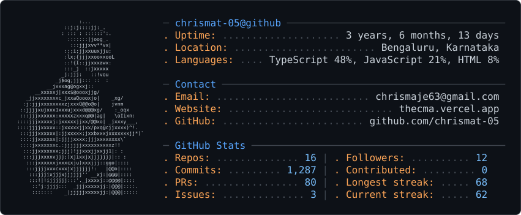
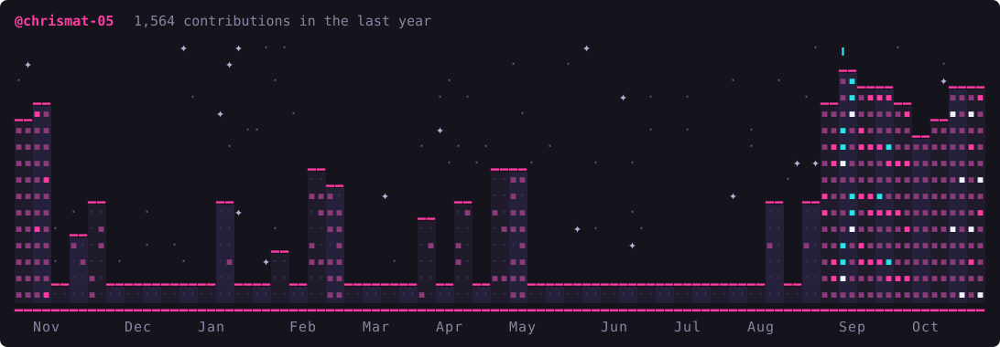

<picture>
  <source media="(prefers-color-scheme: dark)" srcset="assets/dark_mode.svg" />
  <source media="(prefers-color-scheme: light)" srcset="assets/light_mode.svg" />
  
</picture>

 

# 💫 About Me:
I’m Chris Mathew Aje, pursuing my BCA at Kristu Jayanti College in Bengaluru. I enjoy digging into tech, discover and build things that work well to suit needs. Whether it’s web development, backend systems, or custom project setups, I am into figuring out how to make things simpler and smoother. I’ve had hands-on experience organizing my projects under subdomains on [thecma.xyz](https://thecma.xyz), so it's organized and professional. But I’m not all code and logic. I’ve got a creative side too, especially when it comes to design. I look into the details, how appealing it is, from layout to color choices. I’ve made websites for communities I’m part of and always try to make them feel fresh and intentional. Whether it’s for my portfolio or something I’m just experimenting with, I prefer building projects that reflect my personality. To me, creativity and tech go hand-in-hand, and I’m just taking it one step at a time, always trying to bridge the two.

 

## 🌐 Socials:

---

  

---

### ☕ Support

